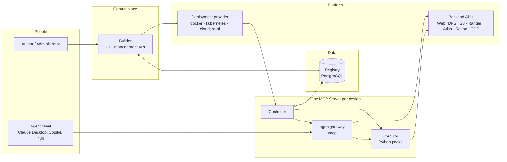
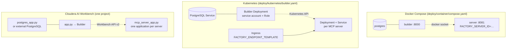
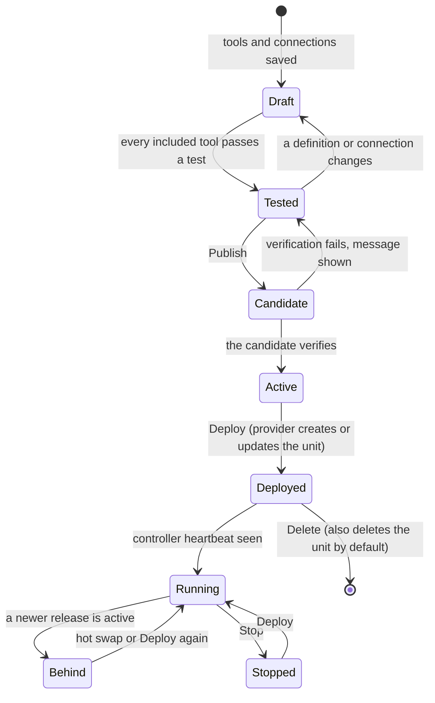
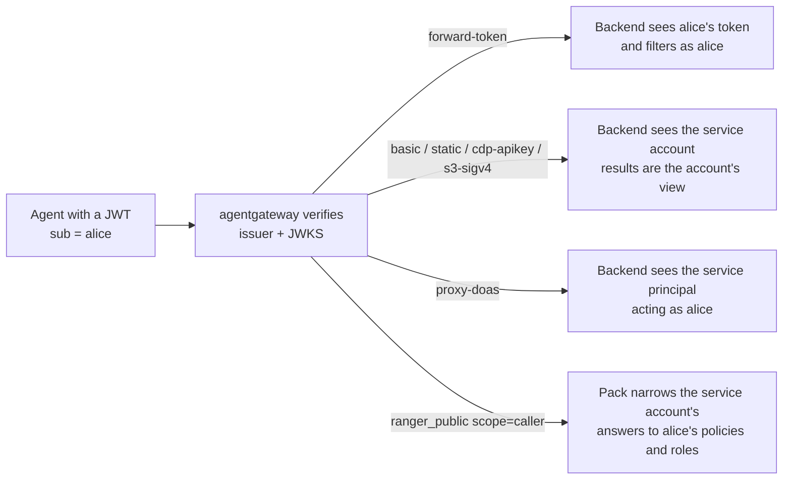
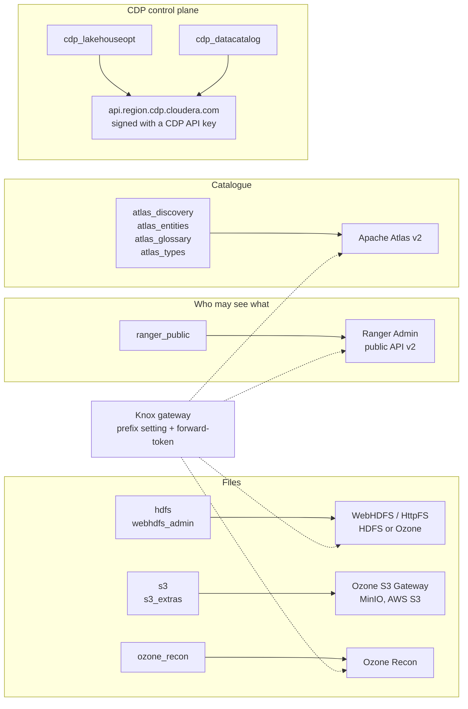
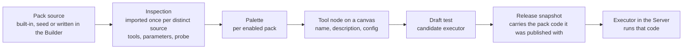

# Daedalus user guide

Daedalus turns the APIs of a data platform into governed MCP tools that an AI agent can call, without anyone pushing code or restarting an application. You design a server on a canvas, test every tool against the real API, publish an immutable release, and deploy it where your platform runs. This guide is for the four kinds of people who touch Daedalus: administrators who install and operate it, authors who build servers, agent consumers who connect clients to them, and developers who write tool packs.

Where a feature has been verified only against the fakes in Daedalus's own test suite and not yet against a real installation, the guide says so in a note like this one:

> **Verified against fakes only.** The behaviour is tested end to end in Daedalus, but not yet against the real product.

Last updated: 2026-11-02. The diagrams numbered C and E are drawn as inline SVG; the rest use Mermaid. GitHub does not render inline SVG in Markdown, so read this guide in an editor preview, a documentation site, or the exported page when you need those two.

---

## Part 1. What Daedalus is

### 1.1 The problem it solves

Data platforms expose hundreds of HTTP operations: WebHDFS, the Ozone S3 Gateway, Ranger, Atlas, Recon, the CDP control plane. An agent needs a small, well-described, safe subset of them, called with the right credentials and the right identity, and an operator needs to see what the agent may do and change it without a deployment. Daedalus is the factory that makes those servers: one Builder, many MCP servers, each carrying only the tools someone dragged onto its canvas.

### 1.2 The three pieces

- **The Builder** is the control plane: a web application with a canvas where tools, connections and policies are designed, tested, published and deployed. It is the only place state is changed.
- **An MCP Server** is what agents talk to. There is one per MCP server you design. It runs a *controller* that supervises *agentgateway* (the MCP endpoint and request router) and, when a release has Python tools, an *executor* (a loopback Python service that runs pack functions). It serves the last release it was given and keeps serving if the Builder is unavailable.
- **The registry** is a PostgreSQL database shared by the Builder and the Servers: server workspaces, tools, connections, origin policies, packs, releases, deployment records, heartbeats and the audit log.



*Diagram A. System overview. Solid arrows are who calls whom. The Builder never sits on an agent's request path.*

### 1.3 Who does what

Daedalus has four management roles. In the local development stack, `FACTORY_AUTH_MODE=development-open` makes everyone an administrator. In token mode, each role has its own management token (`FACTORY_ADMINISTRATOR_TOKEN`, `FACTORY_AUTHOR_TOKEN`, `FACTORY_PUBLISHER_TOKEN`, `FACTORY_VIEWER_TOKEN`) and the header shows the signed-in role. Administrators may do everything below.

| Action | Viewer | Author | Publisher | Administrator |
|---|---|---|---|---|
| Browse servers, tools, connections, releases, source | yes | yes | yes | yes |
| Export a server | yes | yes | yes | yes |
| Create servers, connections, tools; approve origins; test | | yes | | yes |
| Publish releases, Deploy, Stop | | | yes | yes |
| Enable seed packs, write project packs | | | | yes |
| Import a server, Delete a server, edit connections | | | | yes |

Agents never use a management token. They use the server's own MCP token or a JWT from the identity provider (Part 4).

### 1.4 Vocabulary

| Term | Meaning |
|---|---|
| Server workspace | One MCP server as designed: its tools, connections, origins, layout, releases and deployment. The header's server picker switches between them. |
| Tool | One MCP tool. Kinds: `python` (a pack function), `rest` (a GET or POST operation written by hand or imported from OpenAPI), `mcp` (one tool of another MCP server). |
| Connection | A reusable backend endpoint: origin, protocol (`rest`, `webhdfs`, `s3`, `mcp`), authentication mode and the *name* of its secret. |
| Approved origin | A scheme and host an agent may be allowed to reach, approved per server under **API access policies**. Connections and tools are refused for unapproved origins. |
| Pack | A Python module of tools. *Built-in* packs ship in the image, *seed* packs ship in the code but stay off until enabled, *project* packs are written in the Builder and stored in the registry. |
| Release | An immutable snapshot of the tools, connections and pack code of a server, verified in a candidate before it becomes active. |
| Deployment | The unit a provider created for a server: a container, a Kubernetes Deployment and Service, or a Workbench application. |
| Caller identity | The user a tool acts for: the `sub` of a verified JWT on the public port, or a development user when no issuer is configured. |

---

## Part 2. Getting started

### 2.1 Choosing a platform

| Platform | What runs where | Best for |
|---|---|---|
| Docker Compose | PostgreSQL, the Builder and one Server container per MCP server, from one image | evaluation, a single host, development |
| Kubernetes | the Builder as a Deployment with a service account; a Deployment and Service per MCP server | shared clusters, ingress in front of the Servers |
| Cloudera AI Workbench | the Builder, each Server and optionally PostgreSQL as Workbench applications in one project | Cloudera customers who want everything inside the Workbench |



*Diagram B. Deployment topologies. Dotted arrows are the Builder's Deploy action creating the Server through the platform's own API.*

**Docker Compose.** Build the image once and start the reference stack:

```sh
docker build -f deploy/container/Dockerfile --build-arg GIT_REVISION=$(git rev-parse --short=12 HEAD) -t daedalus:local .
docker compose -f deploy/container/compose.yaml --env-file .env up -d
```

The image has one entrypoint with three commands: `builder` migrates the registry and serves the UI and API on `FACTORY_BUILDER_PORT` (default 8000), `server` serves the MCP server named by `FACTORY_SERVER_ID` on `FACTORY_GATEWAY_PORT` (default 8081), and `migrate` runs the schema migration alone. Copy the `server` service once per additional MCP server, or let the `docker` provider create containers for you (Part 3.6).

**Kubernetes.** Apply `deploy/kubernetes/builder.yaml` with your image and a PostgreSQL Service. The Builder needs the Role in that manifest to create Deployments and Services, or `FACTORY_K8S_API_URL` and `FACTORY_K8S_TOKEN` to reach another cluster. Put an ingress in front of the Servers and tell the Builder the public shape with `FACTORY_ENDPOINT_TEMPLATE`, for example `https://{name}.mcp.example.com/mcp`.

**Cloudera AI Workbench.** Clone the repository into a project and build the UI (`cd apps/builder-ui && npm ci && npm run build`). Create one application whose script is the repository-root `app.py`: that is the Builder. When no external PostgreSQL exists, create an application with `postgres_app.py` first and set `FACTORY_PG_PASSWORD`; the Builder and Servers find it through a host file in project storage. Each MCP server becomes an application with the script `mcp_server_app.py` and its own `FACTORY_SERVER_ID`; with the `cloudera-ai` provider the Builder creates those for you through the Workbench API. The launchers translate what Workbench provides (`CDSW_APP_PORT`, `CDSW_DOMAIN`, `CDSW_APIV2_KEY`, `CDSW_PROJECT_ID`) into the `FACTORY_*` variables, and relay each process's output into the application log, so a failed start shows its last 40 lines on the application page.

> **Not yet verified on a real Workbench.** The Workbench launchers and the `cloudera-ai` provider are tested against a fake of the Workbench API. Deploy, Stop, Delete and the seed-pack toggle still need a walk-through on the target Workbench release; see `docs/BURNDOWN.md`, section 3.

### 2.2 The first run

1. Open the Builder. In token mode, paste your management token when asked; the header shows your role and the code revision the Builder is running.
2. Under **API access policies** (the shield in the header), approve the origin of the first backend, scheme and host only, for example `https://atlas.example.com`. Origins are per server workspace: approving one here does not approve it for another server.
3. Pick the language with the selector next to the signed-in user. English and Korean are available; the choice is remembered per browser.
4. If you will use seed packs, open **TOOL PACKS → ⚙ Seed packs** and switch on the ones this server needs. Nothing happens to any server until a tool from the pack is placed on a canvas.

### 2.3 Secrets

Daedalus never stores a credential value. A connection records the *name* of an environment variable, always of the form `FACTORY_SECRET_<NAME>`, and the value lives in the environment of the Server application, the container or the pod. The Builder reads the same variable when it runs a connection check or a draft test. A missing secret fails the test or the release with the variable's name, never silently. Exports list the secret names a server needs so the next environment can set them before the first test.

Each authentication mode expects a particular value shape, listed in Part 3.2.

---

## Part 3. Building a server

### 3.1 The Builder tour

- **The palette** on the left holds building blocks: REST connections and their imported operations, each enabled pack with its tools, MCP connections with their discovered tools, and the **Import OpenAPI** and **New tool pack** actions. Click or drag a block onto the canvas.
- **The canvas** shows tools as nodes linked by edges to the connections they use. A failed test paints the edge red and dashed. Moving nodes only changes the saved layout.
- **The inspector** on the right edits whatever is selected: a tool's name, description, side effects, parameters, connection and configuration JSON, or a connection's details and last check. With nothing selected it shows the server at a glance: draft tools, published tools, connections, the setup steps, and the **live card**.
- **The header** carries the server picker, **New server**, **Export**, **Import**, **Stop**, **Delete**, **Deploy**, the release history, the policies screen, help, the language selector and the signed-in role.
- **The live card** says whether the deployed Server is running, its endpoint, whether it serves the latest release or is behind, and its last heartbeat.

<svg xmlns="http://www.w3.org/2000/svg" viewBox="0 0 1972 590" width="1972" height="590" role="img" aria-label="From an empty canvas to a live MCP endpoint" style="max-width:100%;height:auto;font-family:'IBM Plex Sans', 'Segoe UI', system-ui, sans-serif">
<title>From an empty canvas to a live MCP endpoint</title>
<defs><marker id="dd-arrow" viewBox="0 0 10 10" refX="9" refY="5" markerWidth="7" markerHeight="7" orient="auto-start-reverse"><path d="M0,0 L10,5 L0,10 z" fill="#6b7486"/></marker></defs>
<rect x="0" y="0" width="1972" height="590" rx="10" fill="#ffffff" stroke="#d5dbe4"/>
<rect x="1" y="8" width="1970" height="82" fill="#f4f7fd" stroke="#d5dbe4" stroke-width=".5"/>
<rect x="6" y="8" width="4" height="82" fill="#2459d6"/>
<text x="18" y="46" font-size="14" font-weight="600" fill="#18202f">Author</text>
<text x="18" y="63" font-size="11.5" fill="#5a6476">the Builder in a browser</text>
<rect x="1" y="90" width="1970" height="82" fill="#f8f6fd" stroke="#d5dbe4" stroke-width=".5"/>
<rect x="6" y="90" width="4" height="82" fill="#7445d6"/>
<text x="18" y="128" font-size="14" font-weight="600" fill="#18202f">Builder API</text>
<text x="18" y="145" font-size="11.5" fill="#5a6476">control plane</text>
<rect x="1" y="172" width="1970" height="82" fill="#f5f9f5" stroke="#d5dbe4" stroke-width=".5"/>
<rect x="6" y="172" width="4" height="82" fill="#3d8a2f"/>
<text x="18" y="210" font-size="14" font-weight="600" fill="#18202f">Registry</text>
<text x="18" y="227" font-size="11.5" fill="#5a6476">PostgreSQL</text>
<rect x="1" y="254" width="1970" height="82" fill="#f3f9f8" stroke="#d5dbe4" stroke-width=".5"/>
<rect x="6" y="254" width="4" height="82" fill="#0d8578"/>
<text x="18" y="292" font-size="14" font-weight="600" fill="#18202f">Backend API</text>
<text x="18" y="309" font-size="11.5" fill="#5a6476">the connection's origin</text>
<rect x="1" y="336" width="1970" height="82" fill="#fbf8f3" stroke="#d5dbe4" stroke-width=".5"/>
<rect x="6" y="336" width="4" height="82" fill="#b06f12"/>
<text x="18" y="374" font-size="14" font-weight="600" fill="#18202f">Deployment provider</text>
<text x="18" y="391" font-size="11.5" fill="#5a6476">docker, kubernetes, cloudera-ai</text>
<rect x="1" y="418" width="1970" height="82" fill="#fcf5f7" stroke="#d5dbe4" stroke-width=".5"/>
<rect x="6" y="418" width="4" height="82" fill="#bf3b67"/>
<text x="18" y="456" font-size="14" font-weight="600" fill="#18202f">MCP Server</text>
<text x="18" y="473" font-size="11.5" fill="#5a6476">controller, agentgateway, executor</text>
<rect x="1" y="500" width="1970" height="82" fill="#f7f8f8" stroke="#d5dbe4" stroke-width=".5"/>
<rect x="6" y="500" width="4" height="82" fill="#5f6b7d"/>
<text x="18" y="538" font-size="14" font-weight="600" fill="#18202f">Agent client</text>
<text x="18" y="555" font-size="11.5" fill="#5a6476">Claude Desktop, Copilot, n8n</text>
<line x1="206" y1="8" x2="206" y2="582" stroke="#d5dbe4"/>
<path d="M313.0,80 V180" fill="none" stroke="#6b7486" stroke-width="1.4" marker-end="url(#dd-arrow)"/>
<path d="M398,49.0 H418" fill="none" stroke="#6b7486" stroke-width="1.4" marker-end="url(#dd-arrow)"/>
<path d="M505.0,80 V98" fill="none" stroke="#6b7486" stroke-width="1.4" marker-end="url(#dd-arrow)"/>
<path d="M590,131.0 H610" fill="none" stroke="#6b7486" stroke-width="1.4" marker-end="url(#dd-arrow)"/>
<path d="M697.0,162 V262" fill="none" stroke="#6b7486" stroke-width="1.4" marker-end="url(#dd-arrow)"/>
<path d="M782,131.0 H793 V49.0 H802" fill="none" stroke="#6b7486" stroke-width="1.4" marker-end="url(#dd-arrow)"/>
<path d="M889.0,80 V180" fill="none" stroke="#6b7486" stroke-width="1.4" marker-end="url(#dd-arrow)"/>
<path d="M974,49.0 H985 V131.0 H994" fill="none" stroke="#6b7486" stroke-width="1.4" marker-end="url(#dd-arrow)"/>
<path d="M1081.0,162 V262" fill="none" stroke="#6b7486" stroke-width="1.4" marker-end="url(#dd-arrow)"/>
<path d="M1166,131.0 H1177 V49.0 H1186" fill="none" stroke="#6b7486" stroke-width="1.4" marker-end="url(#dd-arrow)"/>
<path d="M1273.0,80 V98" fill="none" stroke="#6b7486" stroke-width="1.4" marker-end="url(#dd-arrow)"/>
<path d="M1273.0,162 V180" fill="none" stroke="#6b7486" stroke-width="1.4" marker-end="url(#dd-arrow)"/>
<path d="M1358,131.0 H1378" fill="none" stroke="#6b7486" stroke-width="1.4" marker-end="url(#dd-arrow)"/>
<path d="M1465.0,162 V344" fill="none" stroke="#6b7486" stroke-width="1.4" marker-end="url(#dd-arrow)"/>
<path d="M1550,377.0 H1561 V459.0 H1570" fill="none" stroke="#6b7486" stroke-width="1.4" marker-end="url(#dd-arrow)"/>
<path d="M1657.0,428 V246" fill="none" stroke="#6b7486" stroke-width="1.4" marker-end="url(#dd-arrow)"/>
<path d="M1742,459.0 H1753 V541.0 H1762" fill="none" stroke="#6b7486" stroke-width="1.4" marker-end="url(#dd-arrow)"/>
<path d="M1849.0,510 V82" fill="none" stroke="#6b7486" stroke-width="1.4" marker-end="url(#dd-arrow)"/>
<rect x="228" y="18" width="170" height="62" rx="7" fill="#dce4f8" stroke="#2459d6" stroke-width="1.3"/>
<text x="240" y="39" font-size="13" font-weight="600" fill="#18202f">Approve the API origin</text>
<text x="240" y="55" font-size="11" fill="#5a6476">Policies: scheme and host</text>
<text x="240" y="71" font-size="11" fill="#5a6476">only, per server</text>
<circle cx="228" cy="18" r="10" fill="#2459d6"/><text x="228" y="22" font-size="11" font-weight="600" fill="#ffffff" text-anchor="middle">1</text>
<rect x="228" y="182" width="170" height="62" rx="7" fill="#ffffff" stroke="#3d8a2f" stroke-width="1.3" stroke-dasharray="4 3"/>
<text x="240" y="203" font-family="'IBM Plex Mono', ui-monospace, Menlo, monospace" font-size="12.5" font-weight="500" fill="#18202f">api_origins</text>
<text x="240" y="219" font-size="11" fill="#5a6476">enabled, revision,</text>
<text x="240" y="235" font-size="11" fill="#5a6476">audit history</text>
<rect x="420" y="18" width="170" height="62" rx="7" fill="#dce4f8" stroke="#2459d6" stroke-width="1.3"/>
<text x="432" y="39" font-size="13" font-weight="600" fill="#18202f">Add a connection</text>
<text x="432" y="55" font-size="11" fill="#5a6476">base URL, protocol,</text>
<text x="432" y="71" font-size="11" fill="#5a6476">auth mode, secret name</text>
<circle cx="420" cy="18" r="10" fill="#2459d6"/><text x="420" y="22" font-size="11" font-weight="600" fill="#ffffff" text-anchor="middle">2</text>
<rect x="420" y="100" width="170" height="62" rx="7" fill="#ffffff" stroke="#7445d6" stroke-width="1.3" stroke-dasharray="4 3"/>
<text x="432" y="121" font-size="13" font-weight="600" fill="#18202f">Validate</text>
<text x="432" y="137" font-size="11" fill="#5a6476">origin approved; only the</text>
<text x="432" y="153" font-size="11" fill="#5a6476">secret's name is stored</text>
<rect x="612" y="100" width="170" height="62" rx="7" fill="#e9e1f8" stroke="#7445d6" stroke-width="1.3"/>
<text x="624" y="121" font-size="13" font-weight="600" fill="#18202f">Check the connection</text>
<text x="624" y="137" font-size="11" fill="#5a6476">an isolated candidate runs</text>
<text x="624" y="153" font-size="11" fill="#5a6476">the matching pack's probe</text>
<circle cx="612" cy="100" r="10" fill="#7445d6"/><text x="612" y="104" font-size="11" font-weight="600" fill="#ffffff" text-anchor="middle">3</text>
<rect x="612" y="264" width="170" height="62" rx="7" fill="#ffffff" stroke="#0d8578" stroke-width="1.3" stroke-dasharray="4 3"/>
<text x="624" y="285" font-size="13" font-weight="600" fill="#18202f">Probe call</text>
<text x="624" y="301" font-size="11" fill="#5a6476">Atlas lists glossaries,</text>
<text x="624" y="317" font-size="11" fill="#5a6476">Recon cluster state, ...</text>
<rect x="804" y="18" width="170" height="62" rx="7" fill="#dce4f8" stroke="#2459d6" stroke-width="1.3"/>
<text x="816" y="32" font-size="13" font-weight="600" fill="#18202f">Add tools</text>
<text x="816" y="46" font-size="11" fill="#5a6476">from a pack, an OpenAPI</text>
<text x="816" y="60" font-size="11" fill="#5a6476">import, a REST operation</text>
<text x="816" y="74" font-size="11" fill="#5a6476">or a federated MCP server</text>
<circle cx="804" cy="18" r="10" fill="#2459d6"/><text x="804" y="22" font-size="11" font-weight="600" fill="#ffffff" text-anchor="middle">4</text>
<rect x="804" y="182" width="170" height="62" rx="7" fill="#ffffff" stroke="#3d8a2f" stroke-width="1.3" stroke-dasharray="4 3"/>
<text x="816" y="203" font-family="'IBM Plex Mono', ui-monospace, Menlo, monospace" font-size="12.5" font-weight="500" fill="#18202f">tools, layout</text>
<text x="816" y="219" font-size="11" fill="#5a6476">drafts; nothing is</text>
<text x="816" y="235" font-size="11" fill="#5a6476">published yet</text>
<rect x="996" y="100" width="170" height="62" rx="7" fill="#e9e1f8" stroke="#7445d6" stroke-width="1.3"/>
<text x="1008" y="114" font-size="13" font-weight="600" fill="#18202f">Test a tool</text>
<text x="1008" y="128" font-size="11" fill="#5a6476">compile; start a candidate</text>
<text x="1008" y="142" font-size="11" fill="#5a6476">gateway and executor;</text>
<text x="1008" y="156" font-size="11" fill="#5a6476">call the tool once</text>
<circle cx="996" cy="100" r="10" fill="#7445d6"/><text x="996" y="104" font-size="11" font-weight="600" fill="#ffffff" text-anchor="middle">5</text>
<rect x="996" y="264" width="170" height="62" rx="7" fill="#ffffff" stroke="#0d8578" stroke-width="1.3" stroke-dasharray="4 3"/>
<text x="1008" y="285" font-size="13" font-weight="600" fill="#18202f">The real API call</text>
<text x="1008" y="301" font-size="11" fill="#5a6476">with the connection's</text>
<text x="1008" y="317" font-size="11" fill="#5a6476">credentials</text>
<rect x="1188" y="18" width="170" height="62" rx="7" fill="#dce4f8" stroke="#2459d6" stroke-width="1.3"/>
<text x="1200" y="39" font-size="13" font-weight="600" fill="#18202f">Publish a release</text>
<text x="1200" y="55" font-size="11" fill="#5a6476">every included tool must</text>
<text x="1200" y="71" font-size="11" fill="#5a6476">have a passing test</text>
<circle cx="1188" cy="18" r="10" fill="#2459d6"/><text x="1188" y="22" font-size="11" font-weight="600" fill="#ffffff" text-anchor="middle">6</text>
<rect x="1188" y="100" width="170" height="62" rx="7" fill="#ffffff" stroke="#7445d6" stroke-width="1.3" stroke-dasharray="4 3"/>
<text x="1200" y="114" font-size="13" font-weight="600" fill="#18202f">Snapshot</text>
<text x="1200" y="128" font-size="11" fill="#5a6476">tools, connections, pack</text>
<text x="1200" y="142" font-size="11" fill="#5a6476">code; immutable; verified</text>
<text x="1200" y="156" font-size="11" fill="#5a6476">in a candidate first</text>
<rect x="1188" y="182" width="170" height="62" rx="7" fill="#ffffff" stroke="#3d8a2f" stroke-width="1.3" stroke-dasharray="4 3"/>
<text x="1200" y="203" font-family="'IBM Plex Mono', ui-monospace, Menlo, monospace" font-size="12.5" font-weight="500" fill="#18202f">releases</text>
<text x="1200" y="219" font-size="11" fill="#5a6476">history; restore keeps</text>
<text x="1200" y="235" font-size="11" fill="#5a6476">current drafts</text>
<rect x="1380" y="100" width="170" height="62" rx="7" fill="#e9e1f8" stroke="#7445d6" stroke-width="1.3"/>
<text x="1392" y="121" font-size="13" font-weight="600" fill="#18202f">Deploy</text>
<text x="1392" y="137" font-size="11" fill="#5a6476">Deploy panel: provider</text>
<text x="1392" y="153" font-size="11" fill="#5a6476">creates or updates the unit</text>
<circle cx="1380" cy="100" r="10" fill="#7445d6"/><text x="1380" y="104" font-size="11" font-weight="600" fill="#ffffff" text-anchor="middle">7</text>
<rect x="1380" y="346" width="170" height="62" rx="7" fill="#ffffff" stroke="#b06f12" stroke-width="1.3" stroke-dasharray="4 3"/>
<text x="1392" y="360" font-size="13" font-weight="600" fill="#18202f">Create the Server</text>
<text x="1392" y="374" font-size="11" fill="#5a6476">a container, a Deployment</text>
<text x="1392" y="388" font-size="11" fill="#5a6476">+ Service, or a Workbench</text>
<text x="1392" y="402" font-size="11" fill="#5a6476">application</text>
<rect x="1572" y="428" width="170" height="62" rx="7" fill="#f5e0e7" stroke="#bf3b67" stroke-width="1.3"/>
<text x="1584" y="442" font-size="13" font-weight="600" fill="#18202f">Controller starts</text>
<text x="1584" y="456" font-size="11" fill="#5a6476">reads the release, starts</text>
<text x="1584" y="470" font-size="11" fill="#5a6476">gateway and executor,</text>
<text x="1584" y="484" font-size="11" fill="#5a6476">heartbeats to the registry</text>
<circle cx="1572" cy="428" r="10" fill="#bf3b67"/><text x="1572" y="432" font-size="11" font-weight="600" fill="#ffffff" text-anchor="middle">8</text>
<rect x="1572" y="182" width="170" height="62" rx="7" fill="#ffffff" stroke="#3d8a2f" stroke-width="1.3" stroke-dasharray="4 3"/>
<text x="1584" y="203" font-family="'IBM Plex Mono', ui-monospace, Menlo, monospace" font-size="12.5" font-weight="500" fill="#18202f">runtime heartbeat</text>
<text x="1584" y="219" font-size="11" fill="#5a6476">effective release, host,</text>
<text x="1584" y="235" font-size="11" fill="#5a6476">age; shown on the live card</text>
<rect x="1764" y="510" width="170" height="62" rx="7" fill="#e5e7ea" stroke="#5f6b7d" stroke-width="1.3"/>
<text x="1776" y="531" font-size="13" font-weight="600" fill="#18202f">Connect to /mcp</text>
<text x="1776" y="547" font-size="11" fill="#5a6476">MCP token or a Knox JWT;</text>
<text x="1776" y="563" font-size="11" fill="#5a6476">tools/list shows the canvas</text>
<circle cx="1764" cy="510" r="10" fill="#5f6b7d"/><text x="1764" y="514" font-size="11" font-weight="600" fill="#ffffff" text-anchor="middle">9</text>
<rect x="1764" y="18" width="170" height="62" rx="7" fill="#ffffff" stroke="#2459d6" stroke-width="1.3" stroke-dasharray="4 3"/>
<text x="1776" y="39" font-size="13" font-weight="600" fill="#18202f">Live card</text>
<text x="1776" y="55" font-size="11" fill="#5a6476">running; endpoint; latest</text>
<text x="1776" y="71" font-size="11" fill="#5a6476">or behind release</text>
</svg>

<p><small>Solid numbered boxes are steps in order. Dashed boxes are supporting work in another component. Each lane is one component; a greyed lane takes no part in the flow.</small></p>

*Diagram C. The author's workflow from an empty canvas to a live endpoint. Each row is one component; the numbers are the order a first server is built in.*

### 3.2 Connections

A connection is an origin plus how to speak to it and how to authenticate. Create one from the palette's **+** next to connections, or let the Builder prompt for one the first time you drag a tool that needs it.

**Protocols.** `rest` for any HTTP API, `webhdfs` for HDFS and HttpFS, `s3` for the Ozone S3 Gateway, MinIO or AWS S3, `mcp` for another MCP server. Packs declare the protocol their tools need, and the canvas only links matching pairs.

**Authentication modes.** Pick by what the backend accepts and whose identity the results should reflect.

| Mode | Sends | Secret value | Identity the backend sees | Tools |
|---|---|---|---|---|
| `none` | nothing | | anonymous or network-trusted | all |
| `static` | `Authorization: Bearer <secret>` | the token | the service account | all |
| `basic` | `Authorization: Basic` | `user:password` | the service account (Ranger, Atlas, Recon, LDAP-backed APIs) | all |
| `forward-token` | the caller's own bearer token | | the calling user, as the backend knows them (Knox) | all, needs caller identity |
| `proxy-doas` | `doAs=<caller>` as a fixed principal | keytab name | the calling user, through impersonation | Python only; waits on Kerberos support |
| `s3-sigv4` | AWS Signature Version 4 | `ACCESS_KEY:SECRET_KEY` | the key's owner | Python only |
| `cdp-apikey` | CDP request signing V1 | `ACCESS_KEY_ID:PRIVATE_KEY` from the CDP credentials file | the key's CDP user | Python only |

The three signed modes are Python-only because agentgateway cannot sign requests for REST tools; the Builder says so when such a tool is tested.

**The connection check.** Saving a connection, or **Check connection** in the inspector, runs a probe in an isolated candidate: for a plain REST connection any HTTP answer counts, for `webhdfs` it describes `/`, for `s3` it lists buckets, and when tools from a pack use the connection, that pack's own probe runs instead and reports something meaningful: how many glossaries Atlas has, the Recon cluster totals, which Ranger feature groups answered. The verdict shows in the inspector and as the connection node's status dot.

**Federated MCP servers.** A connection with protocol `mcp` and a base URL ending in `/mcp` is another MCP server, for example one Daedalus built. Checking it discovers its tools. With *Serve this server's tools from here* enabled, releases include them behind this server's authentication. To take only some tools, or rename them, add them individually from the palette instead; each becomes a `kind: mcp` node of its own.

### 3.3 Adding tools

- **From a pack.** Expand the pack in the palette and click or drag a tool. Its parameters and description come from the Python function; you may rename it and rewrite the description for your agents. The **Configuration JSON** field holds the pack's per-tool settings, most often `prefix` (the API's path on the connection, for example a Knox path) and defaults such as a Data Hub CRN.
- **From OpenAPI.** **Import OpenAPI** reads a Swagger or OpenAPI URL and lists its GET and POST operations without creating anything. Pick one, reuse or create a connection, and it becomes a draft REST tool.
- **By hand.** A REST tool is a method, a relative path with `{placeholders}`, typed path and query parameters, and for POST a restricted JSON body schema.
- **From another MCP server.** Each discovered tool under an `mcp` connection can be added on its own.

Every tool has a **side effect** of `read` or `write`. Classify it by what the API actually does, since agent clients use it to decide when to ask for confirmation. Untick **Include in next release** to keep a draft out of what gets published.

### 3.4 Testing a tool

**Validate** checks the definition against the connection and the policies. **Test tool** compiles the whole server into a bundle, starts a temporary candidate gateway and executor, calls the one tool with the arguments you give (JSON inputs go under `body`), and shows the result or the error exactly as an agent would see it. Draft tests use the real backend with the connection's real credentials; nothing is published. A tool whose definition or connection changed after its last passing test must be tested again before the server can publish.

### 3.5 Publishing a release

**Publish** snapshots every included tool, its connection and the pack code it uses into an immutable release, runs it in a temporary candidate first, and then activates it. A running Server that is not pinned to a release hot-swaps to it and verifies the switch; otherwise the Builder activates the release and the next **Deploy** rolls it out. Release history can restore an earlier snapshot while keeping your current drafts. Editing a pack later never changes a published server, because each release carries the code it was published with.



*Diagram D. A release's life. Draft, Tested and Active describe the design; Deployed, Running, Behind and Stopped describe the Server the provider created.*

### 3.6 Deploying

The **Deploy** panel uses the provider the Builder was started with (`FACTORY_DEPLOYMENT_PROVIDER`) and shows what that provider will create, the endpoint pattern, and any configuration it still lacks.

| Provider | Creates | Needs |
|---|---|---|
| `manual` (default) | nothing; shows the name, image and environment to create by hand | |
| `docker` | one container per MCP server | the Docker socket or `FACTORY_DOCKER_HOST`, `FACTORY_SERVER_IMAGE` |
| `kubernetes` | one Deployment and Service per MCP server | the Role in `deploy/kubernetes/builder.yaml`, `FACTORY_SERVER_IMAGE`, optionally namespace, sizes and a pull secret |
| `cloudera-ai` | one Workbench application per MCP server | the project's API key and ID, filled from `CDSW_*` inside Workbench; the Server runs on the Builder's own runtime |

**Refresh** reads the live status from the provider. **Stop** stops the unit; clients lose access until it is deployed again. **Delete** on the header removes the server workspace and everything in it and, by default, the unit as well; the dialog shows what will go, offers an Export first and asks you to type the server's name. The default workspace cannot be removed, only emptied.

### 3.7 Export and import

**Export** downloads `<name>.daedalus.json`: origins, connections with secret names only, tools, layout, discovered MCP tools and the source of any project packs the tools use. The same server always exports to the same file, so exports diff well in version control. **Import** (administrators) creates a new workspace from a file with fresh IDs, untested tools and a list of the secrets to set. Release history is not carried over: test and publish in the new environment.

---

## Part 4. Using a server from an agent

### 4.1 Connecting a client

The endpoint is the Server's `/mcp` URL, shown on the live card (locally `http://localhost:8081/mcp`). Without an identity provider it accepts one static bearer token, `FACTORY_MCP_TOKEN`, which is separate from every management token; management tokens cannot reach `/mcp`.

- **Claude Desktop** wants an OAuth flow for remote servers in its current releases, which Daedalus does not offer yet. A local bridge that adds the bearer header works meanwhile.
- **GitHub Copilot** and **n8n** take an MCP server URL and a bearer header directly.

Once connected, `tools/list` shows exactly the tools on the canvas of the active release, with the names and descriptions the author wrote.

### 4.2 Caller identity

Set `FACTORY_JWT_ISSUER`, optionally `FACTORY_JWT_AUDIENCE`, and `FACTORY_JWT_JWKS_FILE` (the issuer's JWKS, for example Knox's) on the Server. The public port then accepts only that issuer's JWTs, the verified `sub` becomes the caller for every tool, and `forward-token` connections pass the JWT on to backends that accept it. Without an issuer, every call acts as the development user with the static token.



*Diagram F. Whose eyes a tool looks through, by authentication mode. The backend, not Daedalus, enforces access; Daedalus only decides which identity it presents.*

What this means for results: with `forward-token`, Atlas or Ranger hide what alice may not see, so the same question gives different answers to different users. With a service account every caller sees the account's view, which is right for inventory tools and wrong for anything an agent will quote back as "what you may access". The Ranger pack adds a middle ground with its `scope` setting (Part 5.5).

<svg xmlns="http://www.w3.org/2000/svg" viewBox="0 0 1972 426" width="1972" height="426" role="img" aria-label="One tool call through a running Daedalus server" style="max-width:100%;height:auto;font-family:'IBM Plex Sans', 'Segoe UI', system-ui, sans-serif">
<title>One tool call through a running Daedalus server</title>
<defs><marker id="dd-arrow" viewBox="0 0 10 10" refX="9" refY="5" markerWidth="7" markerHeight="7" orient="auto-start-reverse"><path d="M0,0 L10,5 L0,10 z" fill="#6b7486"/></marker></defs>
<rect x="0" y="0" width="1972" height="426" rx="10" fill="#ffffff" stroke="#d5dbe4"/>
<rect x="1" y="8" width="1970" height="82" fill="#f7f8f8" stroke="#d5dbe4" stroke-width=".5"/>
<rect x="6" y="8" width="4" height="82" fill="#5f6b7d"/>
<text x="18" y="46" font-size="14" font-weight="600" fill="#18202f">Agent client</text>
<text x="18" y="63" font-size="11.5" fill="#5a6476">an MCP client</text>
<rect x="1" y="90" width="1970" height="82" fill="#fcf5f7" stroke="#d5dbe4" stroke-width=".5"/>
<rect x="6" y="90" width="4" height="82" fill="#bf3b67"/>
<text x="18" y="128" font-size="14" font-weight="600" fill="#18202f">agentgateway</text>
<text x="18" y="145" font-size="11.5" fill="#5a6476">the public /mcp port</text>
<rect x="1" y="172" width="1970" height="82" fill="#f8f6fd" stroke="#d5dbe4" stroke-width=".5"/>
<rect x="6" y="172" width="4" height="82" fill="#7445d6"/>
<text x="18" y="210" font-size="14" font-weight="600" fill="#18202f">Executor</text>
<text x="18" y="227" font-size="11.5" fill="#5a6476">Python, loopback only</text>
<rect x="1" y="254" width="1970" height="82" fill="#f3f9f8" stroke="#d5dbe4" stroke-width=".5"/>
<rect x="6" y="254" width="4" height="82" fill="#0d8578"/>
<text x="18" y="292" font-size="14" font-weight="600" fill="#18202f">Backend API</text>
<text x="18" y="309" font-size="11.5" fill="#5a6476">Ranger, Atlas, Recon, CDP, ...</text>
<rect x="1" y="336" width="1970" height="82" fill="#ffffff" stroke="#d5dbe4" stroke-width=".5"/>
<rect x="6" y="336" width="4" height="82" fill="#d5dbe4"/>
<text x="18" y="374" font-size="14" font-weight="600" fill="#5a6476" opacity=".6">Controller and registry</text>
<text x="18" y="391" font-size="11.5" fill="#5a6476" font-style="italic" opacity=".6">not on the request path</text>
<line x1="206" y1="8" x2="206" y2="418" stroke="#d5dbe4"/>
<path d="M398,49.0 H409 V131.0 H418" fill="none" stroke="#6b7486" stroke-width="1.4" marker-end="url(#dd-arrow)"/>
<path d="M590,131.0 H610" fill="none" stroke="#6b7486" stroke-width="1.4" marker-end="url(#dd-arrow)"/>
<path d="M697.0,162 V262" fill="none" stroke="#6b7486" stroke-width="1.4" marker-end="url(#dd-arrow)"/>
<path d="M782,131.0 H793 V213.0 H802" fill="none" stroke="#6b7486" stroke-width="1.4" marker-end="url(#dd-arrow)"/>
<path d="M974,213.0 H994" fill="none" stroke="#6b7486" stroke-width="1.4" marker-end="url(#dd-arrow)"/>
<path d="M1166,213.0 H1177 V295.0 H1186" fill="none" stroke="#6b7486" stroke-width="1.4" marker-end="url(#dd-arrow)"/>
<path d="M1358,295.0 H1369 V213.0 H1378" fill="none" stroke="#6b7486" stroke-width="1.4" marker-end="url(#dd-arrow)"/>
<path d="M1550,213.0 H1561 V131.0 H1570" fill="none" stroke="#6b7486" stroke-width="1.4" marker-end="url(#dd-arrow)"/>
<path d="M1742,131.0 H1753 V49.0 H1762" fill="none" stroke="#6b7486" stroke-width="1.4" marker-end="url(#dd-arrow)"/>
<rect x="228" y="18" width="170" height="62" rx="7" fill="#e5e7ea" stroke="#5f6b7d" stroke-width="1.3"/>
<text x="240" y="39" font-family="'IBM Plex Mono', ui-monospace, Menlo, monospace" font-size="12.5" font-weight="500" fill="#18202f">tools/call</text>
<text x="240" y="55" font-size="11" fill="#5a6476">Authorization: Bearer</text>
<text x="240" y="71" font-size="11" fill="#5a6476">MCP token or Knox JWT</text>
<circle cx="228" cy="18" r="10" fill="#5f6b7d"/><text x="228" y="22" font-size="11" font-weight="600" fill="#ffffff" text-anchor="middle">1</text>
<rect x="228" y="346" width="170" height="62" rx="7" fill="#ffffff" stroke="#3d8a2f" stroke-width="1.3" stroke-dasharray="4 3"/>
<text x="240" y="360" font-size="13" font-weight="600" fill="#18202f">Already live</text>
<text x="240" y="374" font-size="11" fill="#5a6476">release written at start or</text>
<text x="240" y="388" font-size="11" fill="#5a6476">hot swap; no control-plane</text>
<text x="240" y="402" font-size="11" fill="#5a6476">call per request</text>
<rect x="420" y="100" width="170" height="62" rx="7" fill="#f5e0e7" stroke="#bf3b67" stroke-width="1.3"/>
<text x="432" y="121" font-size="13" font-weight="600" fill="#18202f">Authenticate</text>
<text x="432" y="137" font-size="11" fill="#5a6476">token hash, or JWT issuer</text>
<text x="432" y="153" font-size="11" fill="#5a6476">+ JWKS: sub is the caller</text>
<circle cx="420" cy="100" r="10" fill="#bf3b67"/><text x="420" y="104" font-size="11" font-weight="600" fill="#ffffff" text-anchor="middle">2</text>
<rect x="612" y="100" width="170" height="62" rx="7" fill="#f5e0e7" stroke="#bf3b67" stroke-width="1.3"/>
<text x="624" y="114" font-size="13" font-weight="600" fill="#18202f">Route by tool kind</text>
<text x="624" y="128" font-size="11" fill="#5a6476">REST tool: straight to the</text>
<text x="624" y="142" font-size="11" fill="#5a6476">backend; Python or MCP tool:</text>
<text x="624" y="156" font-size="11" fill="#5a6476">to the executor</text>
<circle cx="612" cy="100" r="10" fill="#bf3b67"/><text x="612" y="104" font-size="11" font-weight="600" fill="#ffffff" text-anchor="middle">3</text>
<rect x="612" y="264" width="170" height="62" rx="7" fill="#ffffff" stroke="#0d8578" stroke-width="1.3" stroke-dasharray="4 3"/>
<text x="624" y="278" font-size="13" font-weight="600" fill="#18202f">REST tool path</text>
<text x="624" y="292" font-size="11" fill="#5a6476">backend policy adds the</text>
<text x="624" y="306" font-size="11" fill="#5a6476">static or Basic header;</text>
<text x="624" y="320" font-size="11" fill="#5a6476">origin pinned</text>
<rect x="804" y="182" width="170" height="62" rx="7" fill="#e9e1f8" stroke="#7445d6" stroke-width="1.3"/>
<text x="816" y="196" font-size="13" font-weight="600" fill="#18202f">Resolve the function</text>
<text x="816" y="210" font-size="11" fill="#5a6476">per-process key checked;</text>
<text x="816" y="224" font-size="11" fill="#5a6476">ToolContext: caller,</text>
<text x="816" y="238" font-size="11" fill="#5a6476">connection, config</text>
<circle cx="804" cy="182" r="10" fill="#7445d6"/><text x="804" y="186" font-size="11" font-weight="600" fill="#ffffff" text-anchor="middle">4</text>
<rect x="996" y="182" width="170" height="62" rx="7" fill="#e9e1f8" stroke="#7445d6" stroke-width="1.3"/>
<text x="1008" y="196" font-family="'IBM Plex Mono', ui-monospace, Menlo, monospace" font-size="12.5" font-weight="500" fill="#18202f">ctx.client()</text>
<text x="1008" y="210" font-size="11" fill="#5a6476">none, static, basic, forward-</text>
<text x="1008" y="224" font-size="11" fill="#5a6476">token, s3-sigv4, cdp-apikey;</text>
<text x="1008" y="238" font-size="11" fill="#5a6476">base URL = approved origin</text>
<circle cx="996" cy="182" r="10" fill="#7445d6"/><text x="996" y="186" font-size="11" font-weight="600" fill="#ffffff" text-anchor="middle">5</text>
<rect x="1188" y="264" width="170" height="62" rx="7" fill="#d8ebe9" stroke="#0d8578" stroke-width="1.3"/>
<text x="1200" y="278" font-size="13" font-weight="600" fill="#18202f">Backend answers</text>
<text x="1200" y="292" font-size="11" fill="#5a6476">identity filtering happens</text>
<text x="1200" y="306" font-size="11" fill="#5a6476">here: Ranger, Atlas, the</text>
<text x="1200" y="320" font-size="11" fill="#5a6476">warehouse decide</text>
<circle cx="1188" cy="264" r="10" fill="#0d8578"/><text x="1188" y="268" font-size="11" font-weight="600" fill="#ffffff" text-anchor="middle">6</text>
<rect x="1380" y="182" width="170" height="62" rx="7" fill="#e9e1f8" stroke="#7445d6" stroke-width="1.3"/>
<text x="1392" y="196" font-size="13" font-weight="600" fill="#18202f">Compact the result</text>
<text x="1392" y="210" font-size="11" fill="#5a6476">clear shapes, paging flags;</text>
<text x="1392" y="224" font-size="11" fill="#5a6476">a ValueError becomes the</text>
<text x="1392" y="238" font-size="11" fill="#5a6476">tool's error message</text>
<circle cx="1380" cy="182" r="10" fill="#7445d6"/><text x="1380" y="186" font-size="11" font-weight="600" fill="#ffffff" text-anchor="middle">7</text>
<rect x="1572" y="100" width="170" height="62" rx="7" fill="#f5e0e7" stroke="#bf3b67" stroke-width="1.3"/>
<text x="1584" y="121" font-size="13" font-weight="600" fill="#18202f">MCP result</text>
<text x="1584" y="137" font-size="11" fill="#5a6476">structuredContent and text;</text>
<text x="1584" y="153" font-size="11" fill="#5a6476">verified against the schema</text>
<circle cx="1572" cy="100" r="10" fill="#bf3b67"/><text x="1572" y="104" font-size="11" font-weight="600" fill="#ffffff" text-anchor="middle">8</text>
<rect x="1764" y="18" width="170" height="62" rx="7" fill="#e5e7ea" stroke="#5f6b7d" stroke-width="1.3"/>
<text x="1776" y="39" font-size="13" font-weight="600" fill="#18202f">The agent reads it</text>
<text x="1776" y="55" font-size="11" fill="#5a6476">and asks the next question</text>
<circle cx="1764" cy="18" r="10" fill="#5f6b7d"/><text x="1764" y="22" font-size="11" font-weight="600" fill="#ffffff" text-anchor="middle">9</text>
</svg>

<p><small>Solid numbered boxes are steps in order. Dashed boxes are supporting work in another component. Each lane is one component; a greyed lane takes no part in the flow.</small></p>

*Diagram E. One tool call. The Builder and the registry are not on this path; a Server keeps answering with its last release if the Builder is down.*

### 4.3 Reading tool results

The shipped packs share conventions that agents learn quickly:

- **Compact shapes.** Results carry the fields a person would ask about, in `snake_case`, with timestamps as ISO 8601 UTC and byte counts next to a human-readable size where it helps.
- **Paging.** Listings take `limit` and either `offset` or `start_after` / `page_token`, and answer with `count`, `truncated` and, where the API provides one, `next_page_token` or `last_key`. The `page_size` configuration key caps how much one call may return regardless of `limit`.
- **Scoping once.** Settings an agent should not have to repeat, such as a Data Hub CRN or a Data Lake CRN, live in the tool configuration; the matching argument still overrides them.
- **Errors are sentences.** A wrong `prefix` says so and names the setting. A missing endpoint on an older product version says what version added it. A refused credential says which secret to check. Rate limiting says to retry. Agents can act on these without a human reading logs.

---

## Part 5. The tool packs

### 5.1 Seed packs

Every pack from the API catalogue ships in the code as a seed, inert until an administrator switches it on under **TOOL PACKS → ⚙ Seed packs** (or lists it in `FACTORY_PACKS_ENABLED`). Enabling a seed adds its tools to the palette of every server in the project and nothing else: a published server carries only the tools on its canvas. Editing a seed makes a project copy that shadows it; the Builder flags the copy when a newer seed ships, and deleting the copy adopts the new one.



*Diagram G. Where each pack talks to. Dotted lines show the packs that can go through Knox instead of directly, chosen by the `prefix` setting and the connection's authentication mode.*

> **Verified against fakes only.** All twelve packs below are tested end to end against fakes of their APIs in Daedalus's mock service. None has yet been run against a real Ranger, Atlas, Recon or CDP tenant; the WebHDFS and S3 packs have been run against the SeaweedFS S3 gateway and an in-memory WebHDFS. Section 2 of `docs/BURNDOWN.md` lists what each real verification needs.

### 5.2 Files: `hdfs` and `webhdfs_admin`

Built-in `hdfs` (protocol `webhdfs`) manages files over WebHDFS, which HDFS exposes natively and Ozone through HttpFS: `list_directory`, `get_file_status`, `make_directory`, `move`, `delete`, `download_file`, `upload_file`, `copy`. Text comes back as UTF-8 and other data as base64.

Seed `webhdfs_admin` (26 tools) adds what administrators and auditors ask: content summaries and quotas, filesystem status, checksums, paged listings, home and trash directories, permissions, owners, ACLs, access checks, replication, storage policy, times, extended attributes, snapshots (list, diff, create, rename, delete), append and concat.

| Setting | Default | Meaning |
|---|---|---|
| `prefix` | `/webhdfs/v1` | Knox uses `/gateway/<topology>/webhdfs/v1` |
| `follow_redirects` | `false` | follow NameNode 307 redirects; HttpFS needs none |
| `pseudo_auth` | `false` | send `user.name=<caller>` on clusters without Kerberos |
| `allow_recursive_delete` (hdfs) | `false` | permit deleting non-empty directories |
| size caps | 256 KiB / 1 MiB / 64 MiB | download, upload and copy limits |

Example question: *"Who owns /data/shared, what quota does it have, and when was its last snapshot taken?"*

### 5.3 Objects: `s3` and `s3_extras`

Built-in `s3` (protocol `s3`, mode `s3-sigv4`) manages objects: `list_buckets`, `list_objects`, `get_object_info`, `download_object`, `upload_object`, `copy_object`, `move_object`, `delete_object`. Copies are server-side, and large objects copy as multipart uploads so nothing big passes through the executor. Seed `s3_extras` (5 tools) adds a bucket access check, bulk delete up to `max_delete_keys`, and object tags (get, set with merge or replace, delete). Settings: `region`, size caps, `multipart_threshold`, `part_size`.

Example question: *"Tag every object under landing/2026-10/ with retention=90d and delete the ones already tagged expired."*

### 5.4 Inventory: `ozone_recon`

Seed `ozone_recon` (13 tools) reads Ozone's Recon service: volumes, buckets and keys with quotas, ACLs, layout and replication; what a path is and what it holds; disk usage by child, largest first; quota usage; file size distribution in bands; cluster state; storage distribution per datanode; file counts per bucket and band; open-key and pending-deletion summaries.

| Setting | Default | Meaning |
|---|---|---|
| `prefix` | `/api/v1` | or a Knox path |
| `page_size` | 100 | most items per listing |
| `simple_user` | `""` | for a Recon whose simple authentication refuses anonymous callers: `caller` sends the calling user's name, any other value a fixed one |

Recon reports the whole cluster to whoever may reach it; it does not narrow answers to the caller. Endpoints missing on older Recon releases say which release added them.

Example question: *"Which buckets hold the most small files, and is anything paused for deletion?"*

### 5.5 Who may see what: `ranger_public`

Seed `ranger_public` (31 read-only tools) covers Ranger's public API v2: service types, services, service tags, policy search and lookups by id, name, guid and resource, roles, security zones.

| Setting | Default | Meaning |
|---|---|---|
| `prefix` | `/service/public/v2/api` | or a Knox path |
| `scope` | `all` | `caller` narrows policy and role answers to the calling user, so a service-account connection still answers "what may *I* access" |
| `page_size` | 200 | |

Connection: `basic` with a service account (Ranger's Auditor role is the read-only fit), `forward-token` through Knox, or `static`. Roles and zones endpoints missing on Ranger before 2.0 produce a clear message, and the probe reports which feature groups answered.

Example question: *"Which Hive policies give the analysts group access to the sales database, and does alice have the data_steward role?"*

### 5.6 Catalogue: the four Atlas packs

Atlas filters results by the authenticated identity itself, so a `forward-token` connection answers with the caller's view and a `basic` connection with the service account's. All four share `prefix` (default `/api/atlas/v2`, or a Knox path) and the message pattern for endpoints Atlas added in 2.1.

- **`atlas_discovery`** (13): basic, filtered, DSL, full-text and quick searches, attribute prefix search, relationship and related-entity search, saved searches, name suggestions. Settings: `page_size`, `include_deleted`.
- **`atlas_entities`** (13): an entity in full or as a header, by guid or by type and qualified name, several at once, recently classified entities, classifications with propagated ones marked, change history, lineage upstream and downstream as datasets, processes and edges, any relationship by guid. Setting: `max_lineage_depth` (10).
- **`atlas_glossary`** (13): glossaries, their category hierarchy, each term's definition, related terms (synonyms, see-also, broader, narrower) and the data assets a term is assigned to. Glossary objects are visible to every Atlas user; assigned entities follow the caller's view.
- **`atlas_types`** (5): type names and definitions, an entity type with every attribute it carries including the inherited ones and a DSL hint, a classification with the entity types it may be applied to. An agent reads a type here before writing a DSL search.

Example question: *"Find the tables tagged PII that feed the order_summary table, and tell me what the business glossary says 'Customer' means."*

### 5.7 Lakehouse maintenance: `cdp_lakehouseopt`

Seed `cdp_lakehouseopt` (14 tools) reads Cloudera Lakehouse Optimizer through the CDP control plane: environments with their Optimizer Data Hub CRN, Iceberg namespaces and tables with status, the compaction, snapshot-expiry and orphan-cleanup policies with their decoded schedules and arguments, which tables each policy covers, why a table is paused or what its last task did, and the tasks that ran.

| Setting | Default | Meaning |
|---|---|---|
| `datahub_crn` | `""` | the Optimizer Data Hub; `list_environments` shows each environment's |
| `prefix` | `/api/v1/lakehouseopt` | |
| `page_size` | 50 | |

Connection: the control plane for your region (`https://api.us-west-1.cdp.cloudera.com`, `https://api.eu-1...`, `https://api.usg-1.cdp.clouderagovt.com`) with mode `cdp-apikey`. The key is a service identity; CDP applies that user's roles.

Example question: *"Why is finance.ledger paused, and when did compaction last run on sales.orders?"*

### 5.8 Data sharing: `cdp_datacatalog`

Seed `cdp_datacatalog` (4 tools): the Data Shares a Data Lake publishes with their tables, columns, external readers and expiry; whether tables carry fine-grained Ranger policies before they are shared; and the sensitivity tags the Data Compliance profiler suggests. Settings: `datalake_crn`, `environment_crn`, `prefix`, `page_size`. Same connection as the Lakehouse Optimizer pack.

Example question: *"What do we share with Acme, does it include anything without column masking, and what sensitive columns has the profiler flagged this month?"*

### 5.9 Recommended server recipes

| Server | Packs | Connection and identity |
|---|---|---|
| Files | `hdfs`, `webhdfs_admin`, `s3`, `s3_extras` | WebHDFS through Knox with `forward-token`; S3 with the owner's key pair |
| Who may see what | `ranger_public` | `basic` as an Auditor with `scope: caller`, or `forward-token` through Knox |
| Catalogue | the four Atlas packs | `forward-token` through Knox so each user sees their own catalogue |
| Lakehouse maintenance | `cdp_lakehouseopt`, `cdp_datacatalog`, `ozone_recon` | `cdp-apikey` for the control plane; Recon with its own connection |

Keep the agent-facing descriptions short and in the agent's language; the pack docstrings are written for that but you may rewrite them per tool.

---

## Part 6. Writing your own pack

Administrators write project packs in the Builder under **TOOL PACKS → +**. The editor validates the module in an isolated subprocess on save and the tools appear in the palette immediately; nothing is written to disk and no restart is needed. The in-app guide at **Help → Writing a tool pack** has the full reference; this part is the short version.

### 6.1 The contract

```python
"""One paragraph: what the pack reads or changes, for whom. This is the pack's description in the palette."""
from factory.packs import ToolContext, pack_probe, pack_tool

PROTOCOL = "rest"                      # rest, webhdfs or s3: which connections the tools accept
DEFAULTS = {"prefix": "/api/v2"}       # tool configuration keys and defaults

@pack_probe
def probe(ctx: ToolContext) -> dict:
    """Runs on Check connection; return {"ok": True, "message": "..."} or raise."""
    ...

@pack_tool(effect="read", requires_connection=True)
def list_things(ctx: ToolContext, name_contains: str = "", limit: int = 50) -> dict:
    """The agent-facing description. Parameters must be str, int, float or bool."""
    with ctx.client(timeout=30.0) as client:
        response = client.get(ctx.config.get("prefix", DEFAULTS["prefix"]) + "/things", params={"q": name_contains})
    ...
```

`ctx.caller.username` and `ctx.caller.token` are the verified caller; `ctx.connection` is the connection record without its secret; `ctx.config` is the tool's configuration JSON. `ctx.client()` returns an HTTP client already bound to the approved origin and carrying whatever the connection's mode requires: a Basic header, the forwarded token, or a request signer. A pack never reads headers or secrets itself. Raise `ValueError` with a sentence for anything the agent should be told.

### 6.2 Patterns worth copying

- **A `prefix` setting** so the same pack works directly and through a gateway such as Knox.
- **Version tolerance.** When a newer endpoint answers HTML 404 or 405 on an older product, say "This X does not offer Y (added in version Z)" instead of relaying the HTML.
- **Compact shapes** with a `dropped()` helper that removes empty fields, ISO timestamps, and byte counts beside human sizes.
- **Scoping to the caller** where the backend cannot: the Ranger pack's `scope` setting adds `user=<caller>` to policy searches.
- **Defaults in configuration** for values an agent should not repeat, with the argument overriding.



*Diagram H. A pack's life. Editing a pack after a release never changes that release; it only invalidates test evidence for drafts that use it.*

### 6.3 Testing a pack

Project packs are tested in the Builder with **Test tool**. Packs that ship with Daedalus are tested through the executor against fakes in `services/factory/mock_api.py`: a test compiles a bundle with the pack, starts an executor, posts to each tool, and asserts on the compact result. The seed suites under `tests/` are the templates to copy.

---

## Part 7. Operating Daedalus

### 7.1 Upgrading

1. Pull the new code (or pull the new image).
2. Run the migration: the container's `migrate` command, or `PYTHONPATH=services /opt/mcp-factory/venv/bin/python -m factory.migrate` on Workbench. Run it before starting the new Builder.
3. Rebuild the UI on Workbench (`npm run build` in `apps/builder-ui`); container images carry it.
4. Restart the Builder, then the Servers. `GET /healthz` reports the code revision the process loaded, so you can confirm the restart took.

Releases already published keep running on the code they were published with.

### 7.2 Monitoring

- **The live card** per server: running, provisioning, stopped, failed or offline; latest or behind; heartbeat age and host.
- **Health endpoints:** the Builder answers `/healthz` and `/readyz`; a Server answers on its MCP port once its release is live.
- **Logs:** `docker compose logs api server` locally; `kubectl logs` for Deployments; the application log on Workbench, with an optional copy in project storage when `FACTORY_LOG_DIR` is set.
- **Audit:** releases, deletions, emptying, policy changes and deployments are recorded with the reason and the role that did them.

### 7.3 Troubleshooting

| Symptom | Likely cause | What to do |
|---|---|---|
| "API origin is not approved" when saving a connection | the origin is approved for another server or not at all | approve it under API access policies for this server |
| Connection check fails with "check the prefix" | the tool's `prefix` does not match the API path on that host | set `prefix` for direct or Knox access |
| "Secret FACTORY_SECRET_X is not set" | the variable is missing on the Builder (tests) or the Server (releases) | set it on both; the value shape is in Part 3.2 |
| "must be set to user:password" or "ACCESS_KEY_ID:PRIVATE_KEY" | the secret value has the wrong shape | fix the value; the registry stores only the name |
| "Python pack tools only" when testing a REST tool | the connection uses a signed mode | use a pack tool, or a `basic`/`static` connection for REST tools |
| Publish blocked | an included tool changed since its last passing test | test it again, or exclude it from the release |
| Revision conflict on save | someone else saved first | reload and save again |
| Live card says Behind | a newer release is active but the Server is pinned or did not swap | Deploy again, or restart the Server |
| Live card says Offline | no heartbeat | check the unit the provider created; Refresh in the Deploy panel |
| "This X does not offer Y" | the backend is an older release | the message names the version that added the endpoint |
| CDP "rejected the API key" | wrong or expired key, or a clock far from UTC | regenerate the key; check the Server's clock |

### 7.4 Security notes

- Origins are approved per server; removing one from a server does not affect another.
- Credentials never enter the registry, the browser, exports or release bundles; only `FACTORY_SECRET_*` names do. Gateway configuration containing a materialised header is written with owner-only permissions per release.
- Management tokens and the MCP token are separate; management tokens cannot call `/mcp`, and the MCP token cannot manage anything.
- The executor process is given neither the registry credentials nor the management tokens.
- Not yet production grade: OAuth/OIDC on the public port, per-tool caller authorisation, secret providers beyond environment variables, Kerberos. See `docs/BURNDOWN.md`, sections 5 and 6.

---

## Appendix A. Environment variables

| Variable | Where | Meaning |
|---|---|---|
| `DATABASE_URL` | Builder, Server | `postgresql+psycopg://…` to the registry |
| `FACTORY_AUTH_MODE` | Builder | `development-open` (everyone is an administrator) or `development-token` |
| `FACTORY_ADMINISTRATOR_TOKEN`, `FACTORY_AUTHOR_TOKEN`, `FACTORY_PUBLISHER_TOKEN`, `FACTORY_VIEWER_TOKEN` | Builder | management tokens per role, 32+ characters, distinct |
| `FACTORY_MCP_TOKEN` | Server | the bearer token agents use without an identity provider, 32+ characters |
| `FACTORY_ALLOWED_API_ORIGINS` | Builder, Server | bootstrap origins; policies in the UI take over afterwards |
| `FACTORY_BROWSER_ORIGINS` | Builder | allowed browser origins for the UI |
| `FACTORY_SECRET_<NAME>` | Builder (tests), Server (releases) | credential values referenced by connections |
| `FACTORY_SERVER_ID`, `FACTORY_DEPLOYED_RELEASE_ID` | Server | which server a Server process serves, and an optional pin |
| `FACTORY_BUILDER_PORT`, `FACTORY_BUILDER_BIND` | Builder | listening port and interface (container default 8000, all interfaces) |
| `FACTORY_GATEWAY_PORT`, `FACTORY_GATEWAY_BIND`, `FACTORY_PUBLIC_MCP_URL` | Server | the MCP port, interface and advertised URL |
| `FACTORY_PROBE_PORT` | Server | the controller's loopback verification port (15001) |
| `FACTORY_JWT_ISSUER`, `FACTORY_JWT_AUDIENCE`, `FACTORY_JWT_JWKS_FILE` | Server | caller identity on the public port |
| `FACTORY_DEPLOYMENT_PROVIDER` | Builder | `manual`, `docker`, `kubernetes`, `cloudera-ai`, `cloudera-bridge` |
| `FACTORY_SERVER_IMAGE`, `FACTORY_ENDPOINT_TEMPLATE` | Builder | the image the provider runs and the public endpoint shape |
| `FACTORY_DOCKER_HOST`, `FACTORY_DOCKER_NETWORK`, `FACTORY_DOCKER_PUBLISH`, `FACTORY_DOCKER_HOST_NAME` | Builder | docker provider |
| `FACTORY_K8S_API_URL`, `FACTORY_K8S_TOKEN`, `FACTORY_K8S_NAMESPACE`, `FACTORY_K8S_CPU`, `FACTORY_K8S_MEMORY`, `FACTORY_K8S_IMAGE_PULL_SECRET` | Builder | kubernetes provider |
| `FACTORY_CAI_API_URL`, `FACTORY_CAI_API_KEY`, `FACTORY_CAI_PROJECT_ID`, `FACTORY_CAI_DOMAIN`, `FACTORY_CAI_RUNTIME_IDENTIFIER`, `FACTORY_CAI_SCRIPT`, `FACTORY_CAI_HOME`, `FACTORY_CAI_CPU`, `FACTORY_CAI_MEMORY`, `FACTORY_CAI_BYPASS_AUTH` | Builder | cloudera-ai provider; defaults come from `CDSW_*` inside Workbench |
| `FACTORY_PACKS_ENABLED` | Builder | seed packs on by default; the UI toggle overrides per pack |
| `FACTORY_STATE_DIR` | Server | where gateway configuration and secret files are written |
| `FACTORY_LOG_DIR` | Workbench launchers | optional copy of process output in project storage |
| `FACTORY_CODE_REVISION` | both | the Git revision, shown by `/healthz` and the UI |
| `MCP_FACTORY_RUNTIME_IMAGE`, `MCP_FACTORY_PYTHON` | Workbench | the runtime image and its Python |

## Appendix B. Management API for automation

Everything the Builder does is an HTTP call with a management token. The ones scripts most often need:

| Call | Purpose |
|---|---|
| `GET /api/servers`, `POST /api/servers` | list and create server workspaces |
| `GET /api/workspace?server_id=…` | the whole design of one server |
| `POST /api/policies/origins` | approve an origin |
| `POST /api/connections`, `POST /api/connections/{id}/check` | create and check a connection (`If-Match` with the revision) |
| `POST /api/tools`, `POST /api/tools/{id}/test` | create and test a tool |
| `GET /api/packs`, `GET /api/packs/seeds`, `PUT /api/packs/{seed}/enabled` | packs and seed toggles |
| `GET /api/export?server_id=…`, `POST /api/servers/import` | export and import |
| `DELETE /api/servers/{id}?delete_application=true` | delete a server and its unit (`If-Match`) |
| `GET /healthz`, `GET /readyz` | health and the running code revision |

## Appendix C. Glossary

**agentgateway** the open-source MCP gateway Daedalus runs in every Server for protocol handling, authentication and routing. **Candidate** a temporary gateway and executor the Builder starts to test a draft or verify a release before it goes live. **CRN** a Cloudera resource name, the identifier CDP uses for environments, Data Hubs and Data Lakes. **Hot swap** a running Server replacing its live release with a newer one without restarting. **Knox** the Cloudera gateway that fronts cluster services with one URL space and JWT authentication; the `prefix` setting and `forward-token` mode are how packs go through it. **Probe** the function a pack provides to check a connection. **Seed pack** a pack that ships in the code but is inert until enabled.

## Appendix D. Korean edition

The Builder's interface and its help pages exist in English and Korean. This guide is English first; a Korean edition is planned once the content settles, and the standing rule that every interface change ships in both languages continues to apply to the Builder itself.
